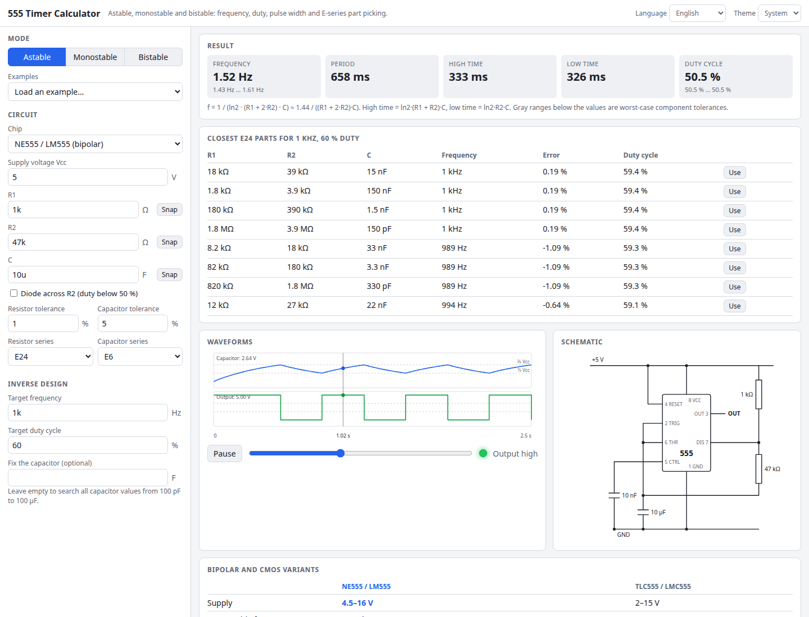

# 555 Timer Calculator

Design a 555 timer circuit in seconds. Pick astable, monostable or bistable, enter R and C, and get frequency, duty cycle or pulse width with worst-case tolerance ranges. Or work backwards: give a target and it finds the closest E-series resistors and capacitors. An animated waveform, a live schematic and NE555 versus CMOS (TLC555) notes complete the picture.

**Try it: [hermes98761234.github.io/timer-555-calculator](https://hermes98761234.github.io/timer-555-calculator/)**

[](https://github.com/hermes98761234/timer-555-calculator/actions/workflows/deploy.yml)



## Features

- **Astable**, including the diode-across-R2 variant for duty cycles below 50 % (with an optional diode forward voltage).
- **Monostable** pulse width, with the non-retriggerable behaviour shown in the waveform.
- **Bistable** (SR latch) set and reset thresholds at Vcc/3 and 2Vcc/3.
- **Inverse design.** Enter a target frequency and duty, or a pulse width, and get the best E3 to E192 resistor and capacitor combinations ranked by error, optionally with a fixed capacitor. One click loads a result.
- **Tolerance analysis.** Worst-case frequency, duty and pulse range from resistor and capacitor tolerances.
- **Animated waveforms** of the capacitor, trigger and output, with a scrubber and an output LED.
- **Schematic SVG** that follows your mode, diode option and part values.
- **Sanity warnings** for supply range, maximum frequency, tiny or huge resistors and capacitors, and an impossible diode drop.
- **Bipolar versus CMOS** comparison (NE555/LM555 against TLC555/LMC555/ICM7555) that also changes the limits used in the warnings.
- Examples, English and Ukrainian, light/dark/system theme, settings saved in the browser. No backend, no tracking.

## How it works

The 555 compares the capacitor voltage with Vcc/3 and 2Vcc/3. From that:

- Astable: high time = ln2 · (R1 + R2) · C, low time = ln2 · R2 · C, so f = 1 / (ln2 · (R1 + 2·R2) · C) ≈ 1.44 / ((R1 + 2·R2) · C).
- Astable with a diode across R2: the capacitor charges through R1 only, so high time = R1 · C · ln((Vcc − Vf − Vcc/3) / (Vcc − Vf − 2Vcc/3)), which is R1 · C · ln2 for an ideal diode.
- Monostable: T = R · C · ln3 ≈ 1.1 · R · C.

E-series values are generated from IEC 60063 (E3 to E24 tables, E48 to E192 as 10^(i/N) rounded to three digits). The inverse search looks at the neighbouring series values around the exact solution for every capacitor and ranks by the worst relative error in frequency and duty. All formulas are unit tested against the textbook values.

Results assume ideal components; real circuits differ by a few percent (output saturation, discharge transistor, capacitor leakage).

## Quick start

```
npm install
npm run dev      # development server
npm run lint && npm test && npm run build
```

## License

MIT, see [LICENSE](LICENSE).
